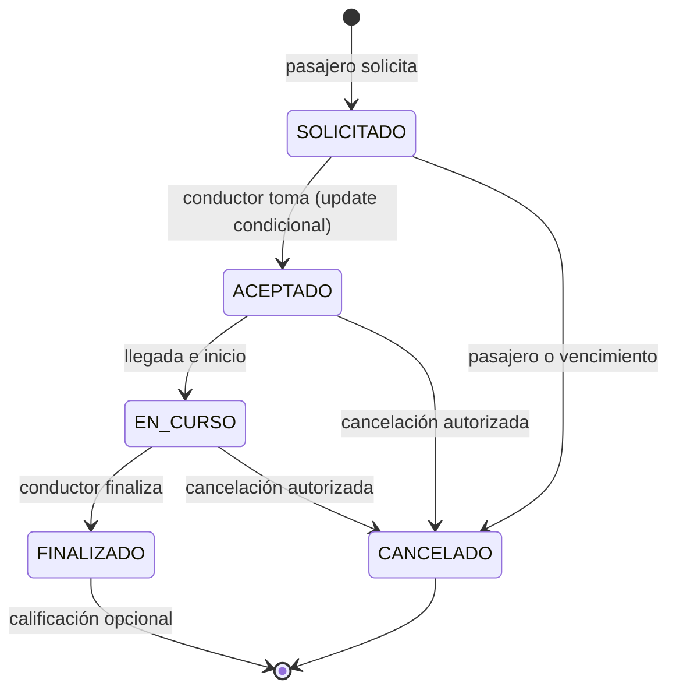

# Flujo de un viaje

El servidor fija el canal `WEB` o `APP` al crear la solicitud y comprueba el propietario y el estado en cada transición. `ServicioRepository.tomarSiDisponible` impide que dos conductores acepten la misma solicitud. `DespachoService` filtra por ola y posición vigente; `DespachoScheduler` amplía olas y vence solicitudes sin conductor. Tras persistir, `ServicioServiceImpl` avisa por STOMP y, para viajes APP, por push. Las vistas por rol pasan por `VisibilidadServicio`, que oculta calificaciones ajenas, comisiones y deuda según el destinatario. Para límites, tarifas y niveles ver `docs/niveles/DECISIONES.md`.
